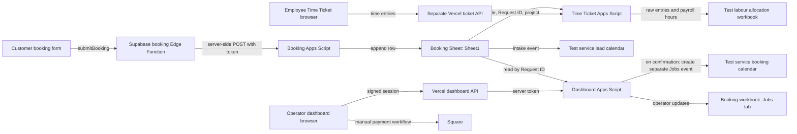

# Shared booking architecture

## Scope and evidence

This is the **test-environment design** for the operator dashboard and the separate employee Time Ticket application. It does not change production systems. The dashboard source, supplied booking form/API/Edge Function and Apps Script, workbook exports, and Time Ticket repository were inspected on 2026-11-01. On that date, the supplied test booking workbook and labour workbook were opened in Google Sheets, and the test Apps Script and both test calendars were inspected. The booking workbook has tabs `Sheet1`, `QuoteLogs`, `Jobs`, and `Quotes`; the labour workbook has `Monthly Summary`, `Pay Period Time Tracker`, `Time Ticket Log`, `Time Ticket Audit`, and `Time Ticket Config`. Both files are still Excel-format `.XLSM`/`.XLSX` workbooks opened in Office editing mode, not converted native Google Sheets. Both workbook time zones are Pacific Time with United States locale; the test Apps Script project and both calendars use `America/Toronto`. Convert the test workbooks to native Google Sheets and align their time zones before validating cross-system dates or payroll formulas. The active booking test deployment is Version 1, executes as the owner, and allows anyone to call the web app; its test source requires a test token and accepts sample-only contact details. Both workbooks currently say “Public on the web. Anyone with the link can open.” Keep their contents synthetic and restrict access when no longer needed for testing.

## System map

The website creates booking requests. `Sheet1` owns intake data and the immutable **Request ID**. The dashboard Apps Script reads that tab and stores operator changes in the `Jobs` tab of the same booking workbook. The dashboard browser uses only same-origin `/api/session` and `/api/jobs`; its server endpoint holds the Apps Script URL and token. The Time Ticket app remains in its own repository. Its Apps Script reads the booking workbook by ID, then writes time entries and allocation hours into a separate labour workbook. Square owns payment transactions; the dashboard currently stores operator-entered payment metadata only.

## Ownership and boundaries

| Data or action | System of record | Current integration |
| --- | --- | --- |
| Booking submission, customer contact, requested service/date | Client booking form and `Sheet1` | The form builds a payload, `bookingApi.ts` invokes Supabase function `booking`, the function forwards to booking Apps Script, and that script appends a row and creates a UUID. Source path verified; deployed behavior pending. |
| Stable Request ID | Booking source | `Sheet1` column Y in the supplied mapping; must be unique and immutable |
| Quote, deposit metadata, status, operator notes, display Job ID | `Jobs` tab | Dashboard Apps Script merges `Jobs` over `Sheet1` by Request ID |
| Payment link, invoice, deposit/balance payment truth | Square | Manual operator action; no Square API or webhook in this dashboard |
| Intake event | Test service lead calendar | Booking Apps Script creates an event after appending the request row; verified with a synthetic test booking |
| Confirmed job event | Test service booking calendar | Dashboard source creates a distinct event and stores its ID in `Jobs.calendarEventId`; it currently leaves the lead-calendar intake event in place. Live dashboard integration is not deployed or verified. |
| Employee job time and submission | `Time Ticket Log` | Separate Time Ticket Apps Script; employee identity is **not yet verified** by that API |
| Payroll allocation hours | Pay-period tracker in labour workbook | Time Ticket script writes rounded hours by job key and employee column |

The dashboard must not infer payment from a link or from a button click. The Time Ticket app must not edit dashboard status or Square state. The labour workbook should receive a Request ID-based job key for booked work, not a customer name or display Job ID as its join key. Customer and employee records, workbook copies with real records, deployment URLs, and tokens must stay out of GitHub.

## Booking-to-job flow

1. The form calls `submitBooking` in `bookingApi.ts`, which invokes the Supabase `booking` Edge Function with the form payload. The function validates the payload and forwards it to booking Apps Script using server environment values. The active test Apps Script generates a fresh UUID per accepted POST, appends a `Sheet1` row, creates an intake event in the **test service lead calendar**, and writes that event ID in column Z (whose current header says `Booking Calendar Event ID`). One synthetic request completed successfully: it created a unique UUID, a nonempty column-Z event ID, and a one-hour event on November 4, 2026 at 10:00 Toronto time. No email or SMS was sent. The test endpoint is publicly callable but requires its test token and enforces sample-only contact values. Retries are not deduplicated, and a failure after append can leave a partial row.
2. The dashboard lists intake rows and joins optional `Jobs` updates by Request ID. A row without an operator update is `NEW` in the dashboard model.
3. An operator prepares a quote and a Square payment link outside this application, then records quote/deposit details in the dashboard. The current button stores `DEPOSIT_SENT`; it does **not** send the link.
4. After checking quote, client acceptance, deposit, and schedule in Square, the operator marks the job confirmed. The Apps Script creates or reconciles the event in the calendar configured by `JOBS_CALENDAR_ID`, persists its distinct `Jobs.calendarEventId`, removes the matching `leadCalendarEventId` event from `LEAD_CALENDAR_ID`, and only then persists `CONFIRMED`. This is a manual verification step, not automatic payment confirmation. Local tests cover retries and partial failures; the deployed test script still needs live verification.
5. An employee selects the booked job in Time Ticket using the booking Request ID, records hours, and submits the day. Its script writes raw entries and rounded allocation hours to the test labour workbook.
6. The operator marks the job `DONE` manually. The dashboard hides completed jobs after 30 days; the row is not deleted by that filter.

## Test-environment verification

The sanitized local workbook copies and a no-notification booking Apps Script fixture are in this repository. The supplied Google Sheets and both supplied calendars were verified as test resources. The booking workbook's active tab names and key headers match the local contract (`Sheet1` A `Service Type`, B `Preferred Date`, G `Full Name`, Y `Request ID`, Z `Booking Calendar Event ID`; `Jobs` A `jobId`, B `requestId`, AF `calendarEventId`). The active labour workbook exposes the five expected tabs. The local labour fixture preserves its formulas and layout while using test worker values; its active Google copy's formulas and protections have not been compared cell by cell. Both workbooks are link-public at present.

The deployed test booking endpoint accepted one synthetic-only request. The row was visible in `Sheet1` row 4 with a UUID Request ID and a nonempty event ID in Z; its event appeared once in the test service lead calendar at the requested Toronto date/time. The event title and sample-only description matched the test script. The Apps Script execution list showed one completed `doPost` web-app execution. The booking calendar did not receive this intake event, matching the intended initial lead-calendar placement. The test Supabase variant was source-checked to forward the token in POST JSON, without a URL token or ad click ID; it is not deployed. Local mocked-source checks cover the dashboard script's current confirmation event creation but do not prove a deployed dashboard flow.

The intake-to-lead test is verified. Dashboard M4–M5 source changes, including lead-to-booking event transfer, are covered by local mocks. The full test-environment acceptance flow remains pending because the dashboard Apps Script has not been deployed to the test booking workbook; workbook format/time-zone alignment also needs confirmation before payroll or date-boundary checks. Configure `LEAD_CALENDAR_ID` and `JOBS_CALENDAR_ID` for the test calendars, deploy the script, then verify quote/confirm, repeat confirmation, both calendar contents, and event ID persistence using synthetic data. No production Sheet, calendar, or script was changed.

## Known implementation gaps

- The user reports that the old dashboard Apps Script was deleted. The only active deployment observed here is the test booking deployment. A separate test dashboard Apps Script deployment is not present, so dashboard-to-Sheet and calendar-transfer behavior has not been exercised in Google.
- The dashboard code can synthesize a Job ID from date plus the first six cleaned Request ID characters. That value may change if the date changes and can collide; it should be stored once for display while Request ID remains the join key.
- The booking source's column X status and the dashboard `Jobs.status` can disagree. The status mapping and precedence must be confirmed before a live migration.
- The exported booking Sheet has a second status field in column AB. Its values differ from column X and the dashboard's canonical states; an explicit owner and translation are needed.
- The form records estimated duration in `details` for moves and junk, but sends `estimatedDurationMinutes` only for deliveries. The booking script therefore leaves estimated time blank for those services and the dashboard may fall back to a two-hour calendar event.
- The live Supabase function puts its booking webhook token in the Apps Script URL query string. The isolated test variant sends a fresh token in POST JSON. Both server functions need a durable idempotency and abuse-control design before relying on retries or high-volume traffic.
- The current Time Ticket endpoint lets callers claim an employee ID without identity verification. Keep its repository and test deployment private, and use only synthetic data until that separate security milestone is complete.
- The booking and labour test workbooks are currently link-public. They contain test copies, but should be restricted when portfolio screenshots or test execution no longer require link access.
