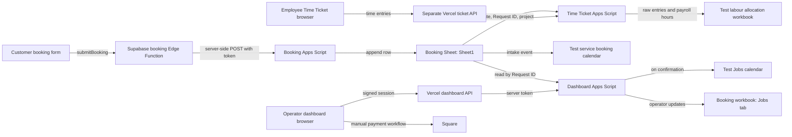

# Shared booking architecture

## Scope and evidence

This is the **test-environment design** for the operator dashboard and the separate employee Time Ticket application. It does not change production Sheets or calendars. The dashboard's checked-in `apps-script/Code.gs`, `api/`, and `src/`, the supplied `BookingForm.tsx`, `bookingApi.ts`, Supabase `booking` Edge Function, and booking Apps Script, the exported booking and labour workbooks, and the Time Ticket repository were inspected on 2026-11-01. The workbook exports establish tab and column structure; they do not establish current Google Sheet sharing, triggers, or time-zone settings. Calendar behavior below is verified in source code, not by observing either test calendar.

## System map

The website creates booking requests. `Sheet1` owns intake data and the immutable **Request ID**. The dashboard Apps Script reads that tab and stores operator changes in the `Jobs` tab of the same booking workbook. The dashboard browser uses only same-origin `/api/session` and `/api/jobs`; its server endpoint holds the Apps Script URL and token. The Time Ticket app remains in its own repository. Its Apps Script reads the booking workbook by ID, then writes time entries and allocation hours into a separate labour workbook. Square owns payment transactions; the dashboard currently stores operator-entered payment metadata only.

## Ownership and boundaries

| Data or action | System of record | Current integration |
| --- | --- | --- |
| Booking submission, customer contact, requested service/date | Client booking form and `Sheet1` | The form builds a payload, `bookingApi.ts` invokes Supabase function `booking`, the function forwards to booking Apps Script, and that script appends a row and creates a UUID. Source path verified; deployed behavior pending. |
| Stable Request ID | Booking source | `Sheet1` column Y in the supplied mapping; must be unique and immutable |
| Quote, deposit metadata, status, operator notes, display Job ID | `Jobs` tab | Dashboard Apps Script merges `Jobs` over `Sheet1` by Request ID |
| Payment link, invoice, deposit/balance payment truth | Square | Manual operator action; no Square API or webhook in this dashboard |
| Intake event | Service booking calendar | Booking Apps Script creates an event after appending the request row |
| Confirmed job event | Service lead/Jobs calendar | Dashboard Apps Script creates a separate event during confirmation |
| Employee job time and submission | `Time Ticket Log` | Separate Time Ticket Apps Script; employee identity is **not yet verified** by that API |
| Payroll allocation hours | Pay-period tracker in labour workbook | Time Ticket script writes rounded hours by job key and employee column |

The dashboard must not infer payment from a link or from a button click. The Time Ticket app must not edit dashboard status or Square state. The labour workbook should receive a Request ID-based job key for booked work, not a customer name or display Job ID as its join key. Customer and employee records, workbook copies with real records, deployment URLs, and tokens must stay out of GitHub.

## Booking-to-job flow

1. The form calls `submitBooking` in `bookingApi.ts`, which invokes the Supabase `booking` Edge Function with the form payload. The function validates the payload and forwards it to booking Apps Script using server environment values. The supplied booking Apps Script generates a fresh UUID per accepted POST, appends a `Sheet1` row, creates a service booking calendar event, writes that event ID into column Z, then sends internal email, optional Twilio SMS, and a customer auto-reply. These sends are removed from the sanitized **test** script. Neither supplied server component has retry deduplication, and a failure after append can leave a partial row.
2. The dashboard lists intake rows and joins optional `Jobs` updates by Request ID. A row without an operator update is `NEW` in the dashboard model.
3. An operator prepares a quote and a Square payment link outside this application, then records quote/deposit details in the dashboard. The current button stores `DEPOSIT_SENT`; it does **not** send the link.
4. After checking the client and payment in Square, the operator marks the job confirmed. The Apps Script sets `CONFIRMED` and creates a Jobs calendar event if it does not already have an event ID. This is a manual verification step, not automatic payment confirmation.
5. An employee selects the booked job in Time Ticket using the booking Request ID, records hours, and submits the day. Its script writes raw entries and rounded allocation hours to the test labour workbook.
6. The operator marks the job `DONE` manually. The dashboard hides completed jobs after 30 days; the row is not deleted by that filter.

## Test environment required to verify the design

Sanitized local workbook copies and a no-notification booking Apps Script fixture now exist. Upload the copies to separate test Google Sheets and use the two dedicated test calendars supplied for service booking and service lead/Jobs events. Keep fresh test-only credentials and test identities. Do not point a test script at the production booking workbook, production labour workbook, or production calendars. The sanitized booking workbook preserves tab names and headers but is rebuilt without private rows or embedded links; the sanitized labour workbook preserves its formulas, layout, and validation while clearing raw entries and replacing worker identities, rates, and GL codes with test values.

Local source checks with mocked Google services verified that an authorized synthetic intake request appends one row, creates a two-hour booking event, and writes its event ID to column Z; a bad token appends nothing. A separate source check verified that the dashboard builds a lead event containing the Request ID. The test Supabase variant was checked to forward its token in POST JSON, without a URL token or ad click ID. These checks do **not** prove Google or Supabase deployment behavior.

Before this document is treated as deployed-and-verified, inspect any live triggers and the test deployments; confirm the imported test Sheets' and Apps Scripts' time zones; and submit/confirm one synthetic booking to verify event timing, title, description, target calendar, and duplicate prevention. Record observed results in `data-contract.md` and `job-lifecycle.md` without copying private rows into Git. The provided calendar IDs identify test targets but do not prove access or behavior.

## Known implementation gaps

- The old dashboard Apps Script deployment/token could not be located or revoked during this audit. A fresh test deployment does not remove access through an old endpoint. Milestone 0 credential rotation remains unverified until the old deployment is disabled or its credential is revoked.
- The dashboard code can synthesize a Job ID from date plus the first six cleaned Request ID characters. That value may change if the date changes and can collide; it should be stored once for display while Request ID remains the join key.
- The booking source's column X status and the dashboard `Jobs.status` can disagree. The status mapping and precedence must be confirmed before a live migration.
- The exported booking Sheet has a second status field in column AB. Its values differ from column X and the dashboard's canonical states; an explicit owner and translation are needed.
- The form records estimated duration in `details` for moves and junk, but sends `estimatedDurationMinutes` only for deliveries. The booking script therefore leaves estimated time blank for those services and the dashboard may fall back to a two-hour calendar event.
- The live Supabase function puts its booking webhook token in the Apps Script URL query string. The isolated test variant sends a fresh token in POST JSON. Both server functions need a durable idempotency and abuse-control design before relying on retries or high-volume traffic.
- The current Time Ticket endpoint lets callers claim an employee ID without identity verification. Keep its repository and test deployment private, and use only synthetic data until that separate security milestone is complete.
